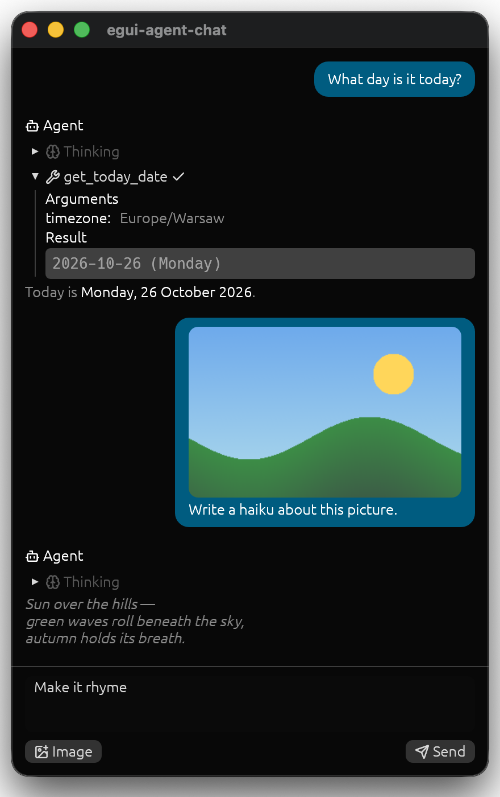

# egui-agent-chat



An [egui](https://github.com/emilk/egui) chat widget for [agentai](https://crates.io/crates/agentai)
agents. Drop it into your app, give it your `Agent`, and get:

- answers streamed in as they are written, rendered as Markdown,
- collapsible reasoning ("Thinking") and tool calls with their arguments and results,
- images returned by tools, or named in their results, shown below the call,
- images in prompts for vision models: dropped on the chat or attached from your code,
- an input where Enter sends and Shift+Enter adds a line (or another shortcut you choose), and
  Stop interrupts the answer,
- the conversation as a plain `Vec<agentai::Message>`, easy to save and restore,
- questions from the agent: a form in the chat with options (text or images) to pick, one or
  several, an "Other" field for the user's own answer, and Skip,
- events for your app: a turn started, finished, was stopped or failed, a tool was called, a
  question was answered,
- context blocks: long material in a prompt shown collapsed under its title, or hidden, and
  context your app adds to the user's next message.

## Quick start

```toml
[dependencies]
agentai = "0.5"
egui-agent-chat = "0.3"
```

The agent comes from your own `agentai` dependency; use 0.5, the version this crate uses.
The chat builds agentai without its default features, so the TLS backend is yours to choose:
agentai's defaults give you rustls with ring, and with `default-features = false` you need to
turn on one of its TLS features (`rustls-ring`, `rustls-aws-lc` or `native-tls`), or HTTPS
requests fail.

```rust
use agentai::Agent;
use egui_agent_chat::ChatPanel;

// Once, e.g. when your app starts
// agentai picks the provider from the model name and reads its key, e.g. OPENAI_API_KEY
let agent = Agent::new("gpt-4.1-mini", "You are helpful.")?;
let runtime = tokio::runtime::Runtime::new()?; // keep it alive as long as the chat
let mut chat = ChatPanel::new(runtime.handle().clone(), agent);

// Every frame, in any egui::Ui
chat.ui(ui);
```

The chat fills the `Ui` it gets; put it in a side panel or a window to share the screen.

For AI coding agents, [`llms.txt`](https://github.com/AxonPod/egui-agent-chat/blob/master/llms.txt) describes the whole integration in one file.

## Controlling the chat from code

| Method                               | What it does                                              |
| ------------------------------------ | --------------------------------------------------------- |
| `send(ctx, prompt)`                  | Sends a message: text or an `agentai::Prompt` with images |
| `cancel()`                           | Stops the answer being written                            |
| `is_running()`                       | Whether the agent is working on an answer                 |
| `set_input(text)`                    | Puts text into the input, e.g. a suggestion               |
| `history()`                          | The conversation, to save it                              |
| `set_history(messages)`              | Restores a conversation; an empty one starts a new chat   |
| `set_pending_context(blocks, label)` | Context that goes with the next message, see below        |

## Reacting to what happens in the chat

`ui` returns the `ChatEvent`s of the frame, in order: `TurnStarted`, `ToolCalled`,
`ToolFinished`, then `TurnFinished`, `TurnStopped` or `TurnFailed { error }`. A stopped or
failed turn stays in the history with what the agent wrote so far. `QuestionAnswered` brings
the user's answer to a question you asked, see below.

```rust
use egui_agent_chat::ChatEvent;

for event in chat.ui(ui) {
    match event {
        // The history has grown: a good moment to save it
        ChatEvent::TurnFinished | ChatEvent::TurnStopped => save(chat.history()),
        ChatEvent::TurnFailed { error } => {
            eprintln!("the turn failed: {error}");
            save(chat.history());
        }
        _ => {}
    }
}
```

## Customizing behavior

All settings can be changed at any time, e.g. from your app's preferences.

### How to change the keyboard shortcut that sends

By default Enter sends and Shift+Enter adds a line, which suits short messages. When people
mostly write longer, multi-line messages, swap them, or pick any other shortcut:

```rust
use egui_agent_chat::SendShortcut;

// Shift+Enter sends, Enter adds a line
chat.set_send_shortcut(SendShortcut::ShiftEnter);

// Cmd+Enter (Ctrl+Enter on Windows and Linux) sends, Enter adds a line
chat.set_send_shortcut(SendShortcut::Custom(egui::KeyboardShortcut::new(
    egui::Modifiers::COMMAND,
    egui::Key::Enter,
)));
```

The placeholder in the input always names the current shortcuts.

### How to enable or disable vision (images in prompts)

Images are off by default, as a text-only model answers an image with an error. For a model
that reads images, enable them:

```rust
use egui_agent_chat::ModelCapabilities;

chat.set_capabilities(ModelCapabilities::default().with_images(true));
```

The user can then drop image files on the chat. Attached images show above the input and go
with the next message. To add images from code, use `chat.attach(agentai::Media::from_bytes(
"image/png", bytes))`. Disabling vision again removes the images already attached.

To draw the images, install image loaders in your app once, e.g.
`egui_extras::install_image_loaders(&cc.egui_ctx)`. The same loaders also show the pictures
that tools name in their results, even with vision disabled.

### How to add your own buttons to the toolbar

The toolbar below the input has Send/Stop on the right. Its left side is yours: draw widgets
there and handle them in the same closure. For example, an image button with your file
picker:

```rust
chat.ui_with_toolbar(ui, |toolbar| {
    let images = toolbar.capabilities().images;
    if toolbar.add_enabled(images, egui::Button::new("🖼 Image")).clicked()
        && let Some(path) = rfd::FileDialog::new().add_filter("PNG", &["png"]).pick_file()
        && let Ok(bytes) = std::fs::read(&path)
    {
        toolbar.attach(agentai::Media::from_bytes("image/png", bytes));
    }
});
```

`toolbar.input()` gives the text being written, to read or change.

### How to hide the toolbar

```rust
chat.set_toolbar(false);
```

Messages are then sent with the shortcut only, and an answer can be stopped only with
`chat.cancel()`, so give users another way to stop it, e.g. a menu item.

### How to let the agent ask the user

`chat.ask(question)` shows a form in the chat: the question, its choices as radio buttons (or
checkboxes with `with_multiple(true)`), optionally an "Other" choice below them with a multi-line text field (`with_other`, with
`with_other_hint` for a hint in it; writing in it chooses it), and Submit and Skip
(`with_declinable_label("None of them")` renames it, `with_declinable(false)` hides it). A
choice is text (`Choice::text`) or a picture (`Choice::image`, needs image loaders), shown up to
160×160 points or `with_image_size(..)`, with a button that shows it large. The answer comes back as `ChatEvent::QuestionAnswered { id, answer }`, with the ids
of the chosen choices and the Other text, or `Answer::Declined`.

```rust
use egui_agent_chat::{Choice, Question, QuestionLayout};

chat.set_question_layout(QuestionLayout::Horizontal); // the default for all questions
chat.ask(
    Question::new(call.id.clone(), "Which format?", vec![
        Choice::text("png", "PNG"),
        Choice::text("jpeg", "JPEG"),
    ])
    .with_other("Another format")
    .with_layout(QuestionLayout::Vertical), // just for this one
);
```

The chat only shows the question and reports the answer; what the agent gets back is up to
you. Usually a tool of yours asks: it gets the `ToolCall` (with `id`) in agentai's
`call_tool`, sends the `Question` with that id to your app (e.g. over a channel), and awaits
the answer. Your app calls `chat.ask` and, on `QuestionAnswered`, sends the answer back to the
tool, which turns it into the tool's result. With the call's id, the form is drawn under that
call and, once answered, shows the answer there; a question with another id goes at the end of
the chat. A question of a tool call goes away when its turn ends without an answer, e.g. on
Stop; `dismiss_question(id)` removes one yourself. `examples/chat/ask.rs` is a complete
`ask_user` tool.

### How to add context to a message

Wrap long material in `context_block(title, body)`: the model gets all of it, the chat shows it
collapsed under `title`. `context_block_hidden(title, body)` makes a block the model gets and
the chat never shows; a user message with nothing but hidden blocks is not drawn at all. The
blocks are plain text in the user's message, so a saved and restored history keeps them.

```rust
use egui_agent_chat::{context_block, context_block_hidden};

let prompt = format!(
    "{}\n\n{}\n\nSummarize it.",
    context_block("notes.md", &notes),
    context_block_hidden("Open files", &open_files),
);
chat.send(ui.ctx(), prompt);
```

The input sends what the user writes by itself. To add context to it, e.g. what changed in
the project since the last message, call `set_pending_context` on any frame. The next message,
written or sent with `send`, starts with one `context_block` per (title, body), and the list
is emptied; `ChatEvent::TurnStarted` tells you it went. The optional label is shown dimmed over
the input while the context waits.

```rust
chat.set_pending_context(
    vec![("Project changes".to_owned(), diff)],
    Some("Project changes will be sent with your message".to_owned()),
);
```

## Async runtime

Turns of the agent run as background tasks started through the `Spawn` trait:

| Feature           | Implementation                               |
| ----------------- | -------------------------------------------- |
| `tokio` (default) | `tokio::runtime::Handle`                     |
| `smol`            | `SmolGlobal`, `Arc<smol::Executor<'static>>` |
| –                 | any closure `Fn(Task)`, for other runtimes   |

agentai's HTTP client needs a tokio reactor. The smol implementations bring one through
[async-compat](https://crates.io/crates/async-compat); with a closure on another runtime, do
the same.

## Example

`examples/chat` opens a window with a chat. It reads the agent's settings from the environment
or a `.env` file:

```sh
AGENTAI_MODEL=gpt-4.1-mini   # agentai picks the provider from the name
OPENAI_API_KEY=...           # whatever that provider needs
AGENTAI_IMAGES=0             # optional: for a model that cannot read images
AGENTAI_QUESTIONS=horizontal # optional: the ask_user tool's options side by side
```

```sh
cargo run --example chat
```

Variables already set in your shell win over `.env`. The menu also switches the send
shortcut, the toolbar and image support. The agent has an `ask_user` tool (`ask.rs`): ask it to
let you choose something.

## Tests

`cargo test` runs the offline tests. `tests/agent.rs` drives the chat against a real model
(answer, tool call, stop, an image in the prompt, smol) with the same environment variables as
the example. The image test needs a vision model.

```sh
cargo test --test agent --features smol -- --ignored
```

## Releasing

Bump `version` in `Cargo.toml`, add its section to `CHANGELOG.md`, commit, then push a
matching tag:

```sh
git tag v0.3.0 && git push origin v0.3.0
```

`.github/workflows/release.yml` runs CI, publishes to crates.io and creates a GitHub release.
It needs a `CARGO_REGISTRY_TOKEN` repository secret.

## License

Licensed under either of
[Apache License, Version 2.0](https://github.com/AxonPod/egui-agent-chat/blob/master/LICENSE-APACHE)
or [MIT license](https://github.com/AxonPod/egui-agent-chat/blob/master/LICENSE-MIT) at your
option. The bundled [Lucide](https://lucide.dev) icon font is under the
[ISC license](https://github.com/AxonPod/egui-agent-chat/blob/master/assets/lucide/LICENSE).
